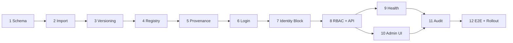

# Dynamic OIDC SSO — Implementation Plan

> **For agentic workers:** REQUIRED SUB-SKILL: Use superpowers:subagent-driven-development (recommended) or superpowers:executing-plans to implement this plan task-by-task. Steps use checkbox (`- [ ]`) syntax for tracking.

**Goal:** Replace the single static external OIDC configuration with secure, versioned multi-provider SSO management for Open CMS Admin Portal while preserving Local Login and existing user identities.

**Architecture:** Keep the existing NestJS OAuth2 Authorization Server, three-hop external IdP flow, and BFF session model. Add `SsoManagementModule` inside `packages/oauth2`, backed by Kysely/PostgreSQL, Redis best-effort cache/invalidation, and existing RBAC/audit services. Implement in independently reviewable vertical slices, without creating a separate package or service.

**Tech Stack:** TypeScript, NestJS 11, Kysely 0.28, PostgreSQL, `oidc-provider` 9, `openid-client` 6, zod, Vitest, Supertest, React Admin Portal, Redis (integration only after verifying existing client).

**Spec:** `docs/superpowers/specs/2026-10-27-dynamic-oidc-sso-design.md` (read alongside this plan).

**Current repository:** `anhdev97/Open-CMS`; the spec is on `docs/dynamic-oidc-sso-design-2026-10-27`, draft PR #10. Do not begin implementation until the spec and this plan are approved.

## Global Constraints

- **Local Login always available**; no `sso_enforced`, `local_login_enabled`, or per-site login policy in MVP.
- SSO scope: **Admin Portal only**; no JIT users or external role import.
- Auto-link only an existing active CMS user with `email_verified === true`; subsequent logins resolve immutable `(provider, subject)`; one CMS user can link multiple IdPs.
- Keep existing legacy `auth_user_identities.provider='oidc'` values during one-time env → DB migration.
- PostgreSQL is authoritative; Redis cannot authorize a request that PostgreSQL would deny.
- Published config versions are immutable; active edits use Draft → Test → Publish; recovery copies a historical version to a **new** Draft.
- Disable/Archive rejects new and in-flight SSO; disabling a Provider retains existing sessions; blocking an identity revokes its sessions; disabling a CMS User revokes all sessions.
- Lifecycle and health are independent; no automatic provider disable or rollback; alerts only in SSO Management.
- RBAC plus 10-minute non-sliding **Local CMS password** step-up for sensitive SSO actions, scoped to one BFF session.
- No secret/token/password/cookie/PKCE verifier in API read responses, Redis, audit or logs.
- Respect the existing `/oauth2/interaction/:uid/idp/:provider` → `/oauth2/idp/:provider/callback` → `/oauth2/interaction/:uid/idp/:provider/complete` flow.
- Follow existing `@opencloudcms/oauth2` naming, Kysely migrations and test conventions; avoid an unnecessary new package.

## Decisions requiring sign-off before coding

The spec is still **Proposed**. Resolve these review gates before the corresponding tasks; recommendations are **not** recorded as user decisions:

1. **In-flight version:** pin exact provider version for up to 600 seconds after start; newer Publish does not change an in-flight login, but Disable/Archive/SSO-off blocks callback. Recommended: accept.
2. **Legacy sessions without provenance:** force reauthentication during rollout to ensure identity-specific Block is reliable. Recommended: revoke unknown-origin sessions at cutover.
3. **Unlink step-up:** spec only mandates step-up for Block/Unblock. Recommended: require it for Unlink as a sensitive identity operation.
4. **Imported provider activation:** test imported configuration and require explicit publish if untested; preserve Local Login throughout. Recommended: operator-confirmed activation.
5. **Health threshold and history retention:** start with 5-minute probe, 3 consecutive technical failures for UNAVAILABLE, 1–2 failures for DEGRADED, recovery after two successful checks; keep 30 days of health events. These are proposed defaults, not approved product requirements.
6. **Provenance binding:** validate a one-time transaction link between external IdP completion, internal AS grant and BFF callback; do not implement targeted revocation until this is proven in an integration test.
7. **Redis:** confirm a shared Redis provider/client and how it is injected. If not present, use a replaceable cache interface and PostgreSQL-only MVP until the dependency is explicitly approved.
8. **Permissions:** reconcile proposed `read_identity_provider` etc. with the current permission registry and existing Super Admin group semantics.

## Review Focus

1. **Concurrent Block vs SSO callback:** after Block commits, no new BFF session may be created for that identity; Task 7 has a race test.
2. **SSRF via DNS rebinding/redirect:** issuer discovery and JWKS must never access loopback, metadata or private addresses in production; Task 3 has hostile-network tests.
3. **Stale Pub/Sub or Redis:** Disable and Block must take effect even when invalidation is missed; Task 4 and Task 7 test authoritative checks.
4. **Imported `oidc` identity:** migration must not duplicate or remap existing links and must not overwrite an Admin-edited provider; Task 2 covers both.
5. **Old provider version in flight:** callback must use pinned version within TTL and reject when disabled, expired or replayed; Task 6 tests these paths.

---

## File map and interface contracts

Existing paths to modify:
- `packages/oauth2/src/db/types.ts`, `src/db/migrations/index.ts`: typed schema + migration registration.
- `packages/oauth2/src/config/schema.ts`: migration-only legacy input, no runtime static provider.
- `packages/oauth2/src/oauth2.module.ts`: import/export new module and replace static `IDENTITY_PROVIDERS` factory.
- `packages/oauth2/src/idp/identity-provider.ts`, `oidc.identity-provider.ts`, `idp.controller.ts`, `identity-linker.ts`: dynamic versioned external IdP, block precedence, sealed state.
- `packages/oauth2/src/interaction/interaction.controller.ts`, `interaction.service.ts`: dynamic login choices and provenance.
- `packages/oauth2/src/bff/auth.controller.ts`, `session.store.ts`: consume provenance, targeted revocation, step-up.
- `packages/oauth2/src/users/user.service.ts`: ensure disable-user revokes all sessions.
- `packages/core/admin/src/pages/Login.tsx` and appropriate Admin routing/navigation files: login choices and SSO management UI.

New files under `packages/oauth2/src/sso-management/` (keep each focused):
- `sso-management.module.ts` — DI assembly.
- `types.ts` — shared DTO/domain contracts.
- `provider-config.service.ts` — encrypted config drafts, versions and publish.
- `provider-registry.service.ts` — runtime read API and active version lookup.
- `provider-validation.service.ts` — OIDC discovery/JWKS and network safety.
- `login-policy.service.ts` — singleton global SSO switch.
- `identity-block.service.ts` — block/unblock and serialized lookup.
- `auth-provenance.service.ts` — single-use AS → BFF authentication context.
- `step-up.service.ts` — password reauthentication, TTL checks.
- `provider-health.service.ts` — scheduled/manual/passive monitoring.
- `provider-recovery.service.ts` — historical version copy and warning suggestions.
- `provider-cache.service.ts` — non-secret cache and invalidation.
- `controllers/provider-admin.controller.ts`, `policy-admin.controller.ts`, `identity-admin.controller.ts`, `step-up.controller.ts` — Admin API.
- `guards/sso-permission.guard.ts`, `guards/step-up.guard.ts` — server-side enforcement.
- `db/migrations/oauth2_0004_dynamic_sso.ts` — additive DDL.
- `db/migrations/oauth2_0005_sso_provenance.ts` — session/provenance schema, if separate for rollout.
- `test/unit/sso-*.test.ts`, `test/integration/sso-*.test.ts`, `test/e2e/sso-*.test.ts` — tests using existing fixtures.

**Cross-task interfaces (exact TypeScript contracts to implement, refine only by documented review):**

```ts
type ProviderStatus = 'DRAFT' | 'ACTIVE' | 'DISABLED' | 'ARCHIVED';
type ProviderHealth = 'UNKNOWN' | 'HEALTHY' | 'DEGRADED' | 'UNAVAILABLE';
type AuthOrigin = { method: 'local' } | {
  method: 'oidc'; providerCode: string; externalSubject: string;
  providerVersionId: string; identityId?: string;
};
interface ActiveProvider {
  id: string; code: string; versionId: string; label: string;
  issuer: string; clientId: string; clientSecret: string;
  scopes: string[]; claimMapping: Record<string, string>;
}
interface ProviderRegistry {
  listLoginOptions(): Promise<Array<{ code: string; label: string }>>;
  getForStart(code: string): Promise<ActiveProvider | undefined>;
  getForCallback(code: string, versionId: string): Promise<ActiveProvider | undefined>;
}
interface LoginPolicy {
  isSsoEnabled(): Promise<boolean>;
  setSsoEnabled(enabled: boolean, actorId: string, expectedRevision: number): Promise<void>;
}
interface IdentityBlocks {
  assertAllowed(providerCode: string, subject: string): Promise<void>;
  block(input: { providerCode: string; subject: string; reason: string; actorId: string }): Promise<number>;
  unblock(input: { providerCode: string; subject: string; actorId: string }): Promise<void>;
}
interface AuthProvenance {
  bind(interactionUid: string, userId: string, origin: AuthOrigin): Promise<void>;
  consumeForBff(internalAuthContextId: string, userId: string): Promise<AuthOrigin>;
}
interface StepUp {
  verifyPassword(sessionIdHash: string, password: string): Promise<void>;
  assertRecent(sessionIdHash: string, now?: Date): Promise<void>;
}
```

**Security note:** `ActiveProvider.clientSecret` is a **trusted runtime-only** object; it must never be returned by controllers or cached in Redis. `AuthProvenance.consumeForBff` must use an actual cryptographically bound internal AS authorization transaction identifier, not a browser-supplied free-form ID. Determine that binding in Task 5; change this interface in the spec/plan if the tested AS hook requires it.

## Phase 1 — Persistence, migration and provider lifecycle

### Task 1: Add SSO schema and Kysely types

**Files:**
- Create: `packages/oauth2/src/db/migrations/oauth2_0004_dynamic_sso.ts`
- Modify: `packages/oauth2/src/db/migrations/index.ts`, `packages/oauth2/src/db/types.ts`
- Test: `packages/oauth2/test/integration/sso-schema.test.ts`

**Interfaces:** Produces `AuthIdentityProvidersTable`, `AuthIdentityProviderVersionsTable`, `AuthLoginPolicyTable`, `AuthIdentityBlocksTable`, `AuthIdentityProviderHealthTable`, `AuthIdentityProviderHealthEventsTable`, `AuthSsoMigrationMarkersTable` in `AuthTables`.

- [ ] **Step 1: Write failing schema integration tests.** Assert provider `code` uniqueness; `(provider_id,version_no)` uniqueness; valid lifecycle and health enums/checks; FK integrity; one global policy row; active identity block uniqueness; existing `auth_user_identities` unchanged.
- [ ] **Step 2: Run targeted test.** `pnpm exec vitest run packages/oauth2/test/integration/sso-schema.test.ts` → expected FAIL before migration.
- [ ] **Step 3: Implement additive Kysely DDL and types.** Use Postgres constraints/indexes; ensure provider active/draft pointers belong to the same provider via FK/transaction validation; initialize policy `sso_login_enabled=false`.
- [ ] **Step 4: Run targeted test and typecheck.** `pnpm exec vitest run packages/oauth2/test/integration/sso-schema.test.ts && pnpm --filter @opencloudcms/oauth2 typecheck` → PASS.
- [ ] **Step 5: Commit.** `git add packages/oauth2/src/db packages/oauth2/test/integration/sso-schema.test.ts && git commit -m "feat(oauth2): add dynamic SSO persistence schema"`

### Task 2: Idempotent legacy OIDC import

**Files:**
- Create: `packages/oauth2/src/sso-management/legacy-oidc-import.service.ts`
- Modify: `packages/oauth2/src/config/schema.ts`, `packages/oauth2/src/oauth2.module.ts` (bootstrap wiring only), `packages/oauth2/src/db/types.ts` if necessary
- Test: `packages/oauth2/test/integration/sso-legacy-import.test.ts`

**Interfaces:** `LegacyOidcImportService.importOnce(config: { issuer: string; clientId: string; clientSecret: string; label: string } | undefined): Promise<'imported' | 'already_imported' | 'not_configured'>`. Import only, **not** runtime lookup.

- [ ] **Step 1: Write failing tests.** Given legacy env config, import `code='oidc'` and encrypted version 1; repeated import is no-op; existing DB edits are never overwritten; `auth_user_identities.provider='oidc'` and subject remain unchanged; missing/invalid legacy input never disables Local Login.
- [ ] **Step 2: Run.** `pnpm exec vitest run packages/oauth2/test/integration/sso-legacy-import.test.ts` → FAIL.
- [ ] **Step 3: Implement transactionally guarded import.** Use migration marker and unique provider code; derive encryption key using existing `security/crypto.ts` conventions; redact errors; mark untested import as requiring validation/activation per approved decision.
- [ ] **Step 4: Run test and typecheck.** Same Vitest command plus package typecheck → PASS.
- [ ] **Step 5: Commit.** `git add packages/oauth2 && git commit -m "feat(oauth2): import legacy OIDC provider once"`

### Task 3: Draft, Test, Publish and recovery versioning

**Files:**
- Create: `packages/oauth2/src/sso-management/types.ts`, `provider-config.service.ts`, `provider-validation.service.ts`, `provider-recovery.service.ts`
- Test: `packages/oauth2/test/unit/sso-provider-config.test.ts`, `packages/oauth2/test/integration/sso-publish.test.ts`, `packages/oauth2/test/unit/sso-ssrf.test.ts`

**Interfaces:** `ProviderConfigService.createDraft(input, actorId)`, `updateDraft(providerId, patch, expectedRevision, actorId)`, `testDraft(providerId, actorId)`, `publish(providerId, expectedFingerprint, actorId)`, `disable(providerId, actorId)`, `archive(providerId, actorId)`; `ProviderRecoveryService.createFromVersion(providerId, sourceVersionId, actorId)`.

- [ ] **Step 1: Write failing unit/integration tests.** Active version immutable while draft changes; draft edits clear test fingerprint; Publish requires matching tested fingerprint and CAS; concurrent Publish has one winner; recovery copies history into a new draft; encrypted secret absent from read DTOs; SSRF tests reject private/link-local/metadata IPs, redirect to private IP and DNS rebinding.
- [ ] **Step 2: Run targeted tests.** `pnpm exec vitest run packages/oauth2/test/unit/sso-provider-config.test.ts packages/oauth2/test/integration/sso-publish.test.ts packages/oauth2/test/unit/sso-ssrf.test.ts` → FAIL.
- [ ] **Step 3: Implement services.** Validate HTTPS discovery/JWKS with strict issuer, PKCE/OIDC capabilities and bounded network calls; test must not claim end-to-end client secret verification. Publish uses one PostgreSQL transaction and revision check; encrypted secrets stay in DB/trusted runtime only.
- [ ] **Step 4: Re-run tests and typecheck.** Targeted tests + `pnpm --filter @opencloudcms/oauth2 typecheck` → PASS.
- [ ] **Step 5: Commit.** `git add packages/oauth2 && git commit -m "feat(oauth2): versioned SSO provider lifecycle"`

### Task 4: Global policy, runtime registry and cache boundary

**Files:**
- Create: `packages/oauth2/src/sso-management/login-policy.service.ts`, `provider-registry.service.ts`, `provider-cache.service.ts`
- Test: `packages/oauth2/test/integration/sso-registry.test.ts`, `packages/oauth2/test/unit/sso-cache.test.ts`

**Interfaces:** Implement `ProviderRegistry` and `LoginPolicy` above. Cache interface `invalidate(providerId: string, revision: number): Promise<void>`; never serialize `clientSecret`.

- [ ] **Step 1: Write failing tests.** SSO off → no login options; Local Login unaffected; ACTIVE only; DISABLED/ARCHIVED denied even with stale Redis data; missed Pub/Sub invalidation resolved by authoritative check; Redis outage does not make disabled provider available; no secret in cached values/events.
- [ ] **Step 2: Run targeted tests.** `pnpm exec vitest run packages/oauth2/test/integration/sso-registry.test.ts packages/oauth2/test/unit/sso-cache.test.ts` → FAIL.
- [ ] **Step 3: Implement DB-first policy/registry.** Add non-secret Redis cache adapter only after confirming existing client wiring; use revision invalidation + bounded TTL; security checks read PostgreSQL. Avoid a Redis hard dependency if not present.
- [ ] **Step 4: Re-run tests and typecheck.** Targeted tests + typecheck → PASS.
- [ ] **Step 5: Commit.** `git add packages/oauth2 && git commit -m "feat(oauth2): add dynamic SSO registry and policy"`

## Phase 2 — Authentication and security integration

### Task 5: Prove AS-to-BFF authentication provenance binding

**Files:**
- Create: `packages/oauth2/src/sso-management/auth-provenance.service.ts`, `packages/oauth2/src/db/migrations/oauth2_0005_sso_provenance.ts`
- Modify: `packages/oauth2/src/db/migrations/index.ts`, `packages/oauth2/src/db/types.ts`, `packages/oauth2/src/interaction/interaction.service.ts`, `packages/oauth2/src/bff/auth.controller.ts`, `packages/oauth2/src/bff/session.store.ts`
- Test: `packages/oauth2/test/integration/sso-provenance.test.ts`

**Interfaces:** `AuthProvenance.bind(interactionUid,userId,origin)` and `consumeForBff(internalAuthContextId,userId)`, revised only after proving the binding mechanism; `SessionStore.create(userId,tokens,meta,origin)`.

- [ ] **Step 1: Write failing integration tests.** External OIDC interaction yields exactly one correct provider+subject+version on BFF session; local interaction yields `local`; swapping browser cookies/interaction IDs cannot steal provenance; replay is rejected; abandoned transaction expires after 600 seconds; absent provenance fails closed (not mislabeled local).
- [ ] **Step 2: Run targeted test.** `pnpm exec vitest run packages/oauth2/test/integration/sso-provenance.test.ts` → FAIL.
- [ ] **Step 3: Implement a bounded proof of the internal AS hook.** Inspect `ProviderService`, `oidc-provider` interaction completion and internal authorization code/grant mapping. Persist a one-time auth-context record keyed to a **server-authenticated** internal transaction; consume only when internal BFF token exchange proves same transaction/user. Document any necessary spec/interface amendment before proceeding.
- [ ] **Step 4: Implement schema and BFF session origin persistence.** Extend `auth_sessions` and `SessionRow`; preserve legacy unknown-origin rows only under the approved migration policy. Bind and consume once; use cleanup for expired records.
- [ ] **Step 5: Re-run integration tests and typecheck.** Targeted test + typecheck → PASS; commit `git add packages/oauth2 && git commit -m "feat(oauth2): bind authentication origin to BFF sessions"`.

### Task 6: Dynamic external OIDC login and version-pinned callback

**Files:**
- Modify: `packages/oauth2/src/idp/identity-provider.ts`, `oidc.identity-provider.ts`, `idp.controller.ts`, `packages/oauth2/src/interaction/interaction.controller.ts`, `packages/oauth2/src/oauth2.module.ts`
- Test: `packages/oauth2/test/e2e/sso-multi-provider.test.ts`

**Interfaces:** Consume `ProviderRegistry`, `AuthProvenance`; sealed `IdpStartState` gains `versionId`, `startedAt`; linked state gains identity provenance. Provider instance factory `OidcIdentityProvider.fromVersion(config: ActiveProvider, oauthConfig: OAuth2Config)`.

- [ ] **Step 1: Write failing E2E tests.** Two ACTIVE providers render as choices; each callback uses correct provider/version; verified email auto-links existing active CMS user; unverified/missing email never creates a user; same user links two providers; replayed state denied; callback denied after provider Disable/Archive or global SSO off; pinned older version allowed only within approved 600-second window.
- [ ] **Step 2: Run.** `pnpm exec vitest run packages/oauth2/test/e2e/sso-multi-provider.test.ts` → FAIL.
- [ ] **Step 3: Replace static provider array with registry-backed resolution.** Preserve three-hop cookie paths and internal BFF callback; ensure code-to-version binding in encrypted state and call provenance service after identity resolution. Existing local login route remains untouched except provenance recording.
- [ ] **Step 4: Run E2E, existing IdP tests and typecheck.** `pnpm exec vitest run packages/oauth2/test/e2e/sso-multi-provider.test.ts packages/oauth2/test/integration/idp.test.ts packages/oauth2/test/e2e/full-flow.test.ts && pnpm --filter @opencloudcms/oauth2 typecheck` → PASS.
- [ ] **Step 5: Commit.** `git add packages/oauth2 && git commit -m "feat(oauth2): enable dynamic multi-provider SSO login"`

### Task 7: Identity Block/Unlink and targeted session revocation

**Files:**
- Create: `packages/oauth2/src/sso-management/identity-block.service.ts`
- Modify: `packages/oauth2/src/idp/identity-linker.ts`, `packages/oauth2/src/bff/session.store.ts`, `packages/oauth2/src/users/user.service.ts`
- Test: `packages/oauth2/test/integration/sso-identity-block.test.ts`, `packages/oauth2/test/unit/identity-linker.test.ts`

**Interfaces:** Implement `IdentityBlocks`; `SessionStore.revokeByExternalIdentity(providerCode: string, subject: string): Promise<number>`; `SessionStore.revokeAllForUser(userId: string): Promise<number>`. Revoke related internal grants/refresh tokens as appropriate.

- [ ] **Step 1: Write failing tests.** Block before lookup denies existing and new auto-links; Block survives Unlink; Unblock permits login again; Unlink alone retains sessions; Block removes only matching provider+subject sessions while other IdP/local sessions survive; disabled CMS user removes all; concurrent Block/login cannot leave a valid session; stale Redis cannot bypass block.
- [ ] **Step 2: Run.** `pnpm exec vitest run packages/oauth2/test/integration/sso-identity-block.test.ts packages/oauth2/test/unit/identity-linker.test.ts` → FAIL.
- [ ] **Step 3: Implement transaction-safe block and session revocation.** Use keyed subject digest, advisory/row locking, audit in transaction, recheck block immediately before session creation, and durable revocation marker for race safety. Do not rely only on in-memory invalidation.
- [ ] **Step 4: Re-run tests and typecheck.** Targeted tests + typecheck → PASS.
- [ ] **Step 5: Commit.** `git add packages/oauth2 && git commit -m "feat(oauth2): block identities and revoke targeted sessions"`

### Task 8: RBAC, Local Password Step-up and Admin APIs

**Files:**
- Create: `packages/oauth2/src/sso-management/step-up.service.ts`, `guards/sso-permission.guard.ts`, `guards/step-up.guard.ts`, `controllers/provider-admin.controller.ts`, `controllers/policy-admin.controller.ts`, `controllers/identity-admin.controller.ts`, `controllers/step-up.controller.ts`, `sso-management.module.ts`
- Modify: `packages/oauth2/src/oauth2.module.ts`, existing permission registry/validation files found by repo search, `packages/oauth2/src/bff/session.store.ts`
- Test: `packages/oauth2/test/integration/sso-admin-api.test.ts`, `packages/oauth2/test/unit/sso-step-up.test.ts`

**Interfaces:** `StepUp.verifyPassword(sessionIdHash,password)`, `assertRecent(sessionIdHash,now?)`; Admin routes as specified in spec §8, following actual existing routing and error conventions.

- [ ] **Step 1: Write failing tests.** Unauthorized users cannot list or mutate; Super Admin inherits all SSO permissions; sensitive Publish/Disable/Archive/Block/Unblock/policy update requires recent step-up; step-up bound to current BFF session, expires at exactly 600 seconds, never slides; SSO-authenticated Admin with CMS password can step-up; passwordless Admin cannot; wrong password rate-limited; CSRF rejected; API never returns secret.
- [ ] **Step 2: Run.** `pnpm exec vitest run packages/oauth2/test/integration/sso-admin-api.test.ts packages/oauth2/test/unit/sso-step-up.test.ts` → FAIL.
- [ ] **Step 3: Implement guards, controllers and DI.** Verify existing group permissions and `AuthGuard` behavior; reuse `PasswordService`, `AuditService` and error envelope; add server-side `step_up_verified_at` update only after successful password verification. Honor approved Unlink step-up decision.
- [ ] **Step 4: Run targeted tests and typecheck.** Both tests + package typecheck → PASS.
- [ ] **Step 5: Commit.** `git add packages/oauth2 && git commit -m "feat(oauth2): expose secured SSO management APIs"`

## Phase 3 — Operations and Admin experience

### Task 9: Hybrid health monitoring and assisted recovery

**Files:**
- Create: `packages/oauth2/src/sso-management/provider-health.service.ts`
- Modify: `packages/oauth2/src/sso-management/provider-recovery.service.ts`, `sso-management.module.ts`, `controllers/provider-admin.controller.ts`
- Test: `packages/oauth2/test/integration/sso-health.test.ts`

**Interfaces:** `ProviderHealthService.probe(providerId: string): Promise<ProviderHealth>`, `recordTechnicalLoginFailure(providerId, versionId, code)`, `getHistory(providerId, limit)`; recovery suggests prior published version but never changes active version automatically.

- [ ] **Step 1: Write failing tests.** Scheduled probe + manual Test + passive technical failure produce independent health; user cancellation/denied consent do not degrade health; multi-instance distributed lock avoids duplicate probes; stale lock holder cannot overwrite newer health; errors after Publish create in-page recovery suggestion; no automatic Disable or rollback; history is bounded.
- [ ] **Step 2: Run.** `pnpm exec vitest run packages/oauth2/test/integration/sso-health.test.ts` → FAIL.
- [ ] **Step 3: Implement monitoring.** Use approved thresholds, timeout, jitter, concurrency caps and distributed lock if Redis is available; persist health and diagnostic events without credentials/PII; expose read endpoint.
- [ ] **Step 4: Run test and typecheck.** Targeted tests + typecheck → PASS.
- [ ] **Step 5: Commit.** `git add packages/oauth2 && git commit -m "feat(oauth2): monitor SSO health and suggest recovery"`

### Task 10: Admin Portal SSO Management UI and login choices

**Files:**
- Create: `packages/core/admin/src/pages/SsoManagement.tsx`, `packages/core/admin/src/lib/sso-api.ts` (split into focused components if needed)
- Modify: `packages/core/admin/src/pages/Login.tsx`, relevant Admin router/navigation and translation files identified during implementation
- Test: UI tests in the existing Admin test location/convention; add `packages/core/admin/src/pages/SsoManagement.test.tsx` only if configured.

**Interfaces:** Typed client for §8 endpoints; screens: provider list with lifecycle+health, create/edit Draft, Test, Publish, versions/recovery, global SSO toggle, health history, user external identities, Unlink/Block/Unblock, step-up modal.

- [ ] **Step 1: Write failing UI tests using the project's existing runner.** Login always displays Local Login; SSO buttons only when enabled; provider list distinguishes ACTIVE vs DEGRADED; editing draft does not alter published config; secret field is write-only; step-up modal retries one pending action after success; error states preserve Local Login.
- [ ] **Step 2: Run the repository's actual Admin UI test command.** Determine it from `packages/core/admin/package.json` and root test config before execution; expect FAIL for missing UI.
- [ ] **Step 3: Implement typed API client and UI.** Follow existing navigation, auth context, form patterns and i18n; keep permission checks in backend; never render client secret.
- [ ] **Step 4: Run UI tests, Admin typecheck/build and accessibility checks available in repo.** Expect PASS.
- [ ] **Step 5: Commit.** `git add packages/core/admin && git commit -m "feat(admin): add dynamic SSO management experience"`

### Task 11: Audit coverage and retention

**Files:**
- Modify: `packages/oauth2/src/audit/audit.service.ts` only if necessary; SSO services/controllers from Tasks 3–9
- Test: `packages/oauth2/test/integration/sso-audit.test.ts`

**Interfaces:** Existing `AuditService.record` with sanitized event metadata, standardized event types from spec §10.

- [ ] **Step 1: Write failing tests.** Provider create/edit/test/publish/disable/archive/recovery, policy, login success/failure, identity link/unlink/block/unblock, step-up success/failure, targeted revoke each emit event; secrets/tokens/password/cookies/subject plaintext absent; sensitive mutations fail closed if audit transaction fails.
- [ ] **Step 2: Run.** `pnpm exec vitest run packages/oauth2/test/integration/sso-audit.test.ts` → FAIL.
- [ ] **Step 3: Add missing audit events and privacy-safe metadata.** Use request IDs, actor IDs, provider code/version and sanitized reason; add bounded health/audit retention policy hooks only after product retention requirements are approved.
- [ ] **Step 4: Re-run test and typecheck.** Targeted tests + typecheck → PASS.
- [ ] **Step 5: Commit.** `git add packages/oauth2 && git commit -m "test(oauth2): complete SSO audit and privacy coverage"`

## Phase 4 — Release readiness

### Task 12: End-to-end regression, rollout and operational documentation

**Files:**
- Create: `packages/oauth2/test/e2e/sso-admin-flow.test.ts`, `docs/superpowers/runbooks/dynamic-oidc-sso-rollout.md`
- Modify: environment example/docs files containing `OPENCLOUDCMS_IDP_OIDC_*`, `packages/oauth2/src/config/schema.ts` and runtime static factory cleanup once cutover is validated
- Test: full OAuth2 test suite and Admin build.

**Interfaces:** Operational runbook includes preflight backup, Local Login check, idempotent import, activation gate, mixed-version deployment avoidance, provenance cutover, recovery/rollback and monitoring.

- [ ] **Step 1: Write failing end-to-end acceptance tests.** Full login for two providers; legacy `oidc` identity preserved; SSO global off/local on; verified-email linking; block and session revocation; step-up on sensitive action; publish/recovery with live sessions; IdP/Redis outage; no leaked secret.
- [ ] **Step 2: Run.** `pnpm exec vitest run packages/oauth2/test/e2e/sso-admin-flow.test.ts` → FAIL.
- [ ] **Step 3: Implement final migration cutover and runbook.** Remove static runtime provider source only after import+dynamic registry tests pass; document safe rollback of deployment distinct from version recovery. Run DB migration in a test environment first; never apply production migration as part of this task without explicit approval.
- [ ] **Step 4: Verify.** `pnpm exec vitest run packages/oauth2/test && pnpm --filter @opencloudcms/oauth2 typecheck && pnpm --filter @opencloudcms/oauth2 build` → PASS; run actual Admin test/build scripts from package metadata. Check migrations on a fresh DB and upgraded DB; inspect diff for secret leakage.
- [ ] **Step 5: Commit.** `git add packages/oauth2 packages/core/admin docs && git commit -m "docs(oauth2): finalize dynamic SSO rollout and acceptance"`

## Review gates and execution order



**Review checkpoint after each task:** inspect tests, typecheck and diff; verify no secret leakage; commit only the task's coherent slice. Task 5 is a **hard security gate**: if provenance cannot be reliably bound to the internal AS/BFF flow, stop and revise the design rather than shipping partial targeted revocation. Tasks 9 and 10 may be developed in parallel after Task 8 if integration interfaces are frozen.

**Final whole-branch review:** security review for SSRF, OIDC mix-up/state/nonce/PKCE, session provenance, block races, RBAC/step-up, secret redaction, migration idempotency and cache consistency; confirm no non-MVP website SSO or notification features.

**Definition of done:** tests and builds pass; legacy identity links survive; Local Login always works; dynamic provider management is authoritative; sessions are correctly attributed and revoked; provider health and assisted recovery work without automatic rollback; spec acceptance cases pass; runbook is approved. **Do not merge or deploy without explicit authorization.**

## Execution handoff

This plan is for **review only** until approved. Recommended execution mode: **subagent-driven development** with a fresh implementer and reviewer for each task, because the feature crosses OIDC, database, session security and Admin UI. If native execution is preferred, use `superpowers:executing-plans` with the same test/review gates.
