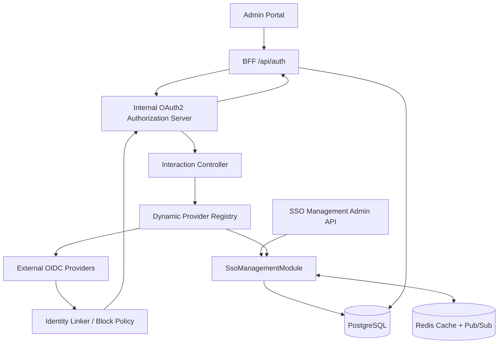

# Dynamic OIDC SSO for Open CMS Admin Portal — Technical Design Specification

**Date:** 2026-10-27  
**Status:** Proposed — awaiting design review and approval  
**Scope:** Admin Portal MVP only  
**Repository:** `anhdev97/Open-CMS`  
**Architecture decision:** Extend `packages/oauth2` with `SsoManagementModule`; do not introduce a separate authentication service.

## 1. Goals, non-goals and invariants

Enable Super Admin to manage multiple standards-compliant OpenID Connect providers (e.g. Microsoft Entra ID, Keycloak, Google) from the Admin Portal, with provider selection on the login screen. PostgreSQL is the configuration source of truth; Redis is an optional distributed acceleration/invalidation layer.

**Agreed invariants:**
- **Local Login always available**, regardless of SSO global switch, provider status, or IdP outage. No `sso_enforced` or `local_login_enabled` flag.
- One **global** provider registry and SSO policy for Admin Portal; no site-level policies in MVP.
- Only **existing, active CMS users** can sign in via SSO. No just-in-time user creation and no external role/permission import.
- First login may auto-link by **verified email**; subsequent logins resolve immutable `(provider_code, subject)`. Multiple identities per CMS user are allowed.
- Disabled/archived providers reject new login attempts and in-flight callbacks; **existing sessions survive provider disable**.
- Disabling a CMS user revokes **all** local and SSO sessions; blocking one identity revokes **only sessions attributable to that identity**; unlink alone does not revoke sessions.
- Secrets and tokens are never returned by read APIs or included in logs, cache events, audit metadata, or browser storage.
- Changes to active provider config use Draft → Test → Publish; rollback creates a new Draft from a prior version, then Test → Publish.
- Lifecycle status and operational health are separate; no automatic disable or rollback.

**Out of scope:** website/front-end user SSO, SAML, SCIM, JIT provisioning, IdP role sync, external logout federation, domain routing, arbitrary OIDC endpoints, automatic rollback, email/webhook alerts, approval workflows, separate identity broker.

**Future-proofing:** versioned provider registry may later support a consumer/scope field, but website login and per-site policy are not exposed in MVP.

## 2. Existing code and impact

Verified against `main`:

| Current component | Current behavior | Change required |
| --- | --- | --- |
| `packages/oauth2/src/config/schema.ts` | One static `idp.oidc` sourced from env/file | One-time bootstrap import; remove static runtime dependency after cutover |
| `packages/oauth2/src/oauth2.module.ts` | `IDENTITY_PROVIDERS` is a static array with at most one `OidcIdentityProvider` | Import/export `SsoManagementModule`; dynamic provider lookup |
| `idp/idp.controller.ts` | Three-hop start → callback → interaction complete, `oc_idp` sealed cookie | Pin provider/version in state; check lifecycle; preserve three hops |
| `interaction/interaction.controller.ts` | Lists static IdPs | Query active registry when global SSO is enabled |
| `idp/identity-linker.ts` | Links existing user by verified email | Check identity blocklist **before** existing-link or email-link lookup |
| `bff/session.store.ts` | `auth_sessions` has user and encrypted token fields but no identity origin | Add immutable authentication provenance and step-up timestamp |
| `db/types.ts` | Kysely `AuthTables` for users, identities, sessions, audit, etc. | Add typed SSO tables and session columns |
| `db/migrations/` | Kysely migration registration | Add additive schema migration(s) |
| `auth_audit_events` | Event metadata JSON | Add typed event conventions, no secrets |

Existing internal Authorization Server uses `oidc-provider`, Authorization Code + PKCE and a confidential Admin BFF client. The browser holds a session cookie; token material stays server-side. The external IdP callback is **not** the same callback as `/api/auth/callback` used by the internal BFF client.

## 3. Architecture and module boundaries



Proposed `packages/oauth2/src/sso-management/`:
- `sso-management.module.ts` — NestJS module, imports existing DB, audit and security dependencies via explicit DI tokens.
- `controllers/identity-provider-admin.controller.ts`, `login-policy.controller.ts`, `identity-link-admin.controller.ts`.
- `services/provider-registry.service.ts`, `provider-version.service.ts`, `provider-health.service.ts`, `provider-recovery.service.ts`, `login-policy.service.ts`, `identity-block.service.ts`, `provider-cache.service.ts`.
- `guards/sso-permission.guard.ts`, `step-up.guard.ts`; DTOs with validation and output redaction.
- Existing `idp/`, `interaction/`, `bff/` and `provider/` remain runtime owners, calling registry/policy interfaces rather than importing admin controllers.

Avoid circular module dependencies: expose provider lookup, policy and identity-block services through a small exported interface/token; ensure singleton services and DI wiring match the existing `OAuth2Module.forRoot` dynamic module.

## 4. Data model (proposed)

All timestamps `timestamptz`, identifiers UUID unless noted, with Kysely types and DB-enforced foreign keys/checks. Sensitive config is encrypted with authenticated encryption and versioned key identifiers; key material is outside the DB.

### 4.1 `auth_identity_providers`

| Column | Type | Constraint / meaning |
| --- | --- | --- |
| `id` | uuid | PK |
| `code` | text | unique, immutable; legacy import uses `oidc` |
| `display_name` | text | nonempty |
| `description` | text nullable | presentation |
| `lifecycle_status` | text | `DRAFT`, `ACTIVE`, `DISABLED`, `ARCHIVED` |
| `active_version_id` | uuid nullable | FK to version belonging to this provider (enforce by transaction/constraint) |
| `draft_version_id` | uuid nullable | optional pointer to single editable draft |
| `display_order` | integer | login order |
| `created_by`, `updated_by` | uuid nullable | admin actor |
| `created_at`, `updated_at`, `archived_at` | timestamptz | lifecycle |

A provider may be disabled while retaining `active_version_id`. Archiving is soft-only; immutable code and identity links remain reserved.

### 4.2 `auth_identity_provider_versions`

| Column | Type | Meaning |
| --- | --- | --- |
| `id` | uuid | PK |
| `provider_id` | uuid | FK |
| `version_no` | integer | unique `(provider_id, version_no)` |
| `state` | text | `DRAFT`, `TESTED`, `PUBLISHED`, `SUPERSEDED` |
| `config_public` | jsonb | issuer, client ID, scopes, auth method, claim mappings, label; **no secret** |
| `client_secret_enc` | text nullable | encrypted secret; never serialized |
| `config_fingerprint` | text | hash of canonicalized full config including secret via keyed digest, not raw SHA of secret |
| `tested_fingerprint` | text nullable | exact config fingerprint that passed Test |
| `tested_at`, `published_at` | timestamptz nullable | gates/history |
| `source_version_id` | uuid nullable | recovery/rollback provenance |
| `created_by`, `published_by` | uuid nullable | actor |
| `created_at`, `updated_at` | timestamptz | metadata |

**Immutability rule:** published version rows never change. Draft edits invalidate `tested_fingerprint` and prior test. To avoid changing a tested version between Test and Publish, use compare-and-swap on `config_fingerprint`, and a transaction locking the provider row. Prefer a new version row when copying a historical version; never repoint directly to a historical version.

### 4.3 `auth_login_policy`

Singleton row `id=1`, `sso_login_enabled boolean`, `updated_by`, `updated_at`, `revision bigint`. Local login has **no toggle**. Do not introduce `sso_enforced`. Optional default-provider/session-age features are deferred unless separately approved.

### 4.4 Identity blocks and identity links

Keep existing `auth_user_identities` unique `(provider,subject)` and historical `provider='oidc'`. Proposed `auth_identity_blocks`: `id`, `provider_code`, `subject_hash` (keyed HMAC for indexed lookup), `subject_enc` only if necessary for audit/admin display, `reason`, `blocked_by`, `blocked_at`, `unblocked_by`, `unblocked_at`. Unique active block per provider/subject; block survives unlink and provider archive. Lookup is performed before link resolution or verified-email auto-link. If a subject is not known for an unlinked identity, block cannot be inferred solely from email; UI must disclose this limitation.

**Race control:** block and link operations must serialize per `(provider,subject)` (e.g. transaction advisory lock) so concurrent auto-link cannot bypass a newly committed block.

### 4.5 Session provenance and step-up

Extend `auth_sessions` with `auth_method` (`local`/`oidc`), `auth_provider_code` nullable, `auth_subject_hash` nullable, `auth_identity_id` nullable, `step_up_verified_at` nullable. Add index `(auth_provider_code, auth_subject_hash)` for targeted revocation and `(user_id)` for disable-user revocation.

**Critical implementation dependency:** provenance must travel through the external IdP callback, internal interaction and Authorization Server to BFF callback in an integrity-protected, one-time, server-side transaction binding. The BFF **must not** infer the external provider from an untrusted query parameter, user email or an arbitrary token claim. Suggested: create an internal auth-context record keyed to the internal authorization transaction/interaction UID; consume it exactly once when establishing the BFF session, and expire/clean up orphan records. Verify whether current `oidc-provider` interaction/grant hooks can carry this binding before implementation. Local password interaction explicitly records `local`. Existing sessions without provenance are legacy/unknown and need a safe transition policy: do not pretend they were SSO sessions; on identity Block, conservatively revoke unknown-origin sessions of that user or force reauthentication during rollout (review choice).

**Revocation:** transactionally delete matching BFF sessions and revoke related internal grants/refresh tokens where supported. Subsequent requests must check session existence; races with refresh/session creation require a monotonic revocation marker or serialized write so a blocked identity cannot retain/create a valid session. `Unlink` does not revoke; `Disable CMS User` revokes all.

### 4.6 Health and recovery

`auth_identity_provider_health`: `provider_id` PK, `health_status` (`UNKNOWN`, `HEALTHY`, `DEGRADED`, `UNAVAILABLE`), `checked_at`, `last_success_at`, `last_failure_at`, `consecutive_failures`, `failure_code`, `active_version_id` evaluated. `auth_identity_provider_health_events`: append-only bounded history with provider/version, category, time and non-sensitive diagnostic code. Recovery suggestion can be derived from version history and post-publish health, rather than a new mutable config state.

## 5. OIDC provider configuration and validation

Immutable provider code; editable display name/description/order and versioned issuer URL, client ID, encrypted client secret, scopes, client authentication method, claim mapping, login label. Support OIDC discovery from issuer; validate issuer exact match, endpoints, HTTPS, allowed redirect URI, and JWKS key material. Require `openid` scope, strict nonce/state/PKCE, signed ID token verification via trusted `openid-client` flow, strict `email_verified === true` (boolean) and normalized email matching. Never accept identity from unsigned userinfo alone or fall back to unverified email.

**SSRF:** reject non-HTTPS and loopback/link-local/private/metadata targets in production, including DNS rebinding and redirects; constrain outbound ports, timeouts, redirects, body size and IP resolution. Allow explicit development-only localhost exception if existing test fixtures require it. Discovery/JWKS URL changes must be validated on each new publish.

**Test Connection** checks discovery, issuer, metadata, JWKS reachability and compatible client-auth metadata; it cannot prove a client secret works or that the IdP allows the actual redirect URI. UI must say so. Successful test stores a fingerprint; any draft change invalidates it. Secret updates are write-only; an omitted secret retains the prior draft secret by explicit update semantics, never echoes it.

## 6. State machines and policies

Provider lifecycle: create `DRAFT`; publish tested draft to `ACTIVE`; `ACTIVE` → `DISABLED` → `ACTIVE` by explicit authorized action with valid active version; `DISABLED` → `ARCHIVED` (and controlled restore). Archive is soft-only. When an active provider is edited, the published version continues serving traffic while a separate draft is edited/tested. Publish swaps active version atomically and invalidates cache. Historical published versions remain immutable for recovery and in-flight authentication.

**In-flight version pinning — implementation proposal pending explicit approval:** bind exact `provider_code + version_id` into sealed state at start; callbacks finish against the pinned version for a bounded 10-minute window, even if a newer version was published. A provider that is now `DISABLED`/`ARCHIVED` or global SSO disabled rejects callback regardless of pinned version. Retain old encrypted credentials until transactions expire and purge per retention policy. An older version must not be usable to start new logins after Publish.

**Health:** independent of lifecycle. Hybrid scheduled discovery/JWKS checks (initial default 5 minutes), manual Test and passive **technical** login errors; user cancellations, invalid passwords and access-denied outcomes are not IdP availability failures. Proposed thresholds: `HEALTHY` on recent successful checks with no significant technical errors; `DEGRADED` on intermittent failures; `UNAVAILABLE` on repeated failed checks and corroborating runtime errors. Persist category/count and time window; use minimum sample sizes to avoid false alerts. Redis distributed lock and jitter prevent multi-instance stampede; lock expiry and fencing avoid stale writers. If Redis unavailable, single-node bounded fallback or skip scheduled checks; login security uses DB.

**Assisted recovery:** after publish, compare technical failure rate to a pre-publish baseline, display an in-page warning and suggested prior version. Admin chooses Create Recovery Draft → Test → Publish. No automatic rollback/disable. No email, webhook, global notification center.

## 7. Authentication sequences

### 7.1 Admin login and provider selection

```mermaid
sequenceDiagram
  participant U as Browser
  participant B as BFF
  participant AS as Internal OAuth2 AS
  participant R as SSO Registry
  participant E as External IdP
  participant L as Identity Linker
  U->>B: GET /api/auth/login
  B->>AS: authorize (state, nonce, PKCE)
  AS->>R: active providers + global SSO policy
  R-->>U: interaction page: Local + enabled OIDC buttons
  U->>AS: /oauth2/interaction/:uid/idp/:provider
  AS->>R: validate ACTIVE and pin version
  AS->>E: authorization request
  E-->>AS: /oauth2/idp/:provider/callback
  AS->>R: recheck lifecycle/policy and pinned version
  AS->>L: resolve (provider, sub, verified email), check blocks
  L-->>AS: existing active CMS user
  AS-->>U: /oauth2/interaction/:uid/idp/:provider/complete
  AS-->>B: internal authorization code
  B->>AS: code exchange
  B->>B: consume bound auth provenance; create BFF session
  B-->>U: secure oc_session cookie
```

Errors fail closed with generic user-facing error codes, detailed sanitized server audit, and no accidental account creation. Local login remains available if global SSO disabled or external IdP down.

### 7.2 Block Identity and session revocation

```mermaid
sequenceDiagram
  participant A as Admin
  participant API as Admin API
  participant DB as PostgreSQL
  participant S as BFF Session Store
  A->>API: POST identity block + reason
  API->>API: RBAC + recent step-up
  API->>DB: transaction: lock identity, upsert active block
  API->>S: revoke sessions by provider + subject hash
  S->>DB: delete BFF sessions; revoke internal grants
  API->>DB: append audit event
  API-->>A: blocked + revocation summary
```

An in-progress login must recheck block state immediately before final session creation. Revocation is idempotent. `Unlink` removes identity association only; blocked identities stay blocked after unlink.

### 7.3 Step-up

```mermaid
sequenceDiagram
  participant A as Admin
  participant API as SSO Admin API
  participant PW as CMS Password Service
  participant DB as Session Store
  A->>API: sensitive action
  API->>DB: validate BFF session, RBAC, step_up_verified_at
  alt recent step-up within 10 minutes
    API-->>A: execute authorized action
  else missing/expired
    API-->>A: STEP_UP_REQUIRED
    A->>API: POST /api/admin/sso/step-up (CMS password)
    API->>PW: verify CMS password with rate limiting
    PW-->>API: success
    API->>DB: update this session step_up_verified_at = now()
    API-->>A: success; retry action
  end
```

The 10-minute window is absolute, not sliding. Step-up does not grant RBAC permissions. Only Admin users with an existing CMS password can manage sensitive SSO operations. Require CSRF defense, constant-time password verification and no password logging.

## 8. Admin API contracts (proposed routes)

All paths are relative to existing NestJS API prefix conventions; exact prefix must be checked against application bootstrap before coding. JSON errors use existing standard API error envelope.

| Method | Route | Purpose | Permission | Step-up |
| --- | --- | --- | --- | --- |
| GET | `/api/admin/sso/providers` | list status, health, versions | `read_identity_provider` | no |
| POST | `/api/admin/sso/providers` | create provider/draft | `create_identity_provider` | no |
| GET | `/api/admin/sso/providers/:id` | read redacted config | `read_identity_provider` | no |
| PATCH | `/api/admin/sso/providers/:id/draft` | edit draft, invalidate test | `update_identity_provider` | no |
| POST | `/api/admin/sso/providers/:id/test` | test draft | `test_identity_provider` | no |
| POST | `/api/admin/sso/providers/:id/publish` | CAS publish tested draft | `publish_identity_provider` | yes |
| POST | `/api/admin/sso/providers/:id/disable` | disable provider | `disable_identity_provider` | yes |
| POST | `/api/admin/sso/providers/:id/restore` | controlled restore | `disable_identity_provider` | yes |
| POST | `/api/admin/sso/providers/:id/archive` | soft archive | `disable_identity_provider` | yes |
| GET | `/api/admin/sso/providers/:id/versions` | version history | `read_identity_provider` | no |
| POST | `/api/admin/sso/providers/:id/recovery-draft` | copy historical version to draft | `update_identity_provider` | no |
| GET | `/api/admin/sso/providers/:id/health` | current health and bounded history | `read_identity_provider` | no |
| GET | `/api/admin/sso/policy` | global SSO flag | `read_login_policy` | no |
| PATCH | `/api/admin/sso/policy` | update global SSO flag | `update_login_policy` | yes |
| GET | `/api/admin/users/:id/external-identities` | linked identities | `read_user` plus identity read policy | no |
| POST | `/api/admin/users/:id/external-identities/:identityId/unlink` | unlink | `manage_user_identity` | policy TBD |
| POST | `/api/admin/sso/identities/block` | block provider + subject | `block_user_identity` | yes |
| POST | `/api/admin/sso/identities/unblock` | unblock | `block_user_identity` | yes |
| POST | `/api/admin/sso/step-up` | verify local password, mark session | authenticated admin | n/a |

Use request IDs, idempotency keys for publish/block where useful, optimistic concurrency (`If-Match`/revision), server-side pagination, and sanitized response DTOs. Never accept provider lifecycle/status, tested flag, publisher ID or health directly from arbitrary PATCH input.

**Permission naming:** existing project uses permission strings and system groups; the proposed new permission names above must be reconciled with the actual registry/validation rules and Super Admin defaults before implementation. The new module must enforce permissions server-side, not only hide UI buttons.

## 9. Cache, consistency and availability

PostgreSQL is authoritative. Redis caches **non-secret** provider summaries, active-version IDs, policy and safe discovery metadata with short TTL; secrets are decrypted from PostgreSQL only inside trusted server runtime and kept in bounded process memory if needed, never in Redis or Pub/Sub. Pub/Sub sends provider ID + revision invalidation events only. Every instance invalidates local cache on event; TTL covers missed messages. Versioned cache keys prevent stale active-version overwrite.

**Security-critical checks** (provider disabled/archived, global SSO switch, identity blocks, user active status, step-up and session revocation) must consult authoritative state at enforcement boundaries; stale Redis data may never override a newer denial. If DB unavailable at callback/publish/block checks, fail closed; do not turn off local login policy by using stale cache. Rate limits and health tasks degrade independently.

## 10. Audit and privacy

Reuse `auth_audit_events`, with event conventions:
- Provider: created, draft_updated, test_passed/failed, published, disabled, archived, restored.
- Version/recovery: recovery_draft_created, publish_conflict, recovery_published.
- Policy: sso_enabled/sso_disabled.
- Authentication: login_succeeded/login_failed/logout; method, provider, version, sanitized failure category.
- Identity: linked, link_failed, unlinked, blocked, unblocked; targeted_sessions_revoked.
- Security: step_up_succeeded/failed, user_disabled, sessions_revoked.

Record timestamp, actor/target user, provider code/version, request/correlation ID, IP and user agent under data retention policy. Store subject as keyed hash or masked value in routine audit metadata; retain only minimum PII. No secret, access/refresh/ID token, authorization code, raw cookies, password, nonce, PKCE verifier or raw callback URL. Audit events for privileged actions should be durable and transactionally coupled with state changes where practical.

## 11. Migration and rollout

1. **Preflight:** inventory static `OPENCLOUDCMS_IDP_OIDC_ISSUER`, `CLIENT_ID`, `CLIENT_SECRET`, `LABEL` and file config; inspect existing `auth_user_identities.provider='oidc'`, session counts and Admin Local Login availability. Take DB backup and verify secret encryption key availability.
2. **Expand:** additive Kysely migrations for provider/version/policy/blocks/health/session provenance; add types and indexes without breaking existing runtime.
3. **One-time idempotent import:** if static OIDC configured and no imported provider exists, create `code='oidc'` and encrypted v1 config; preserve existing identity provider string and subject; never overwrite DB configuration already edited by Admin. Record migration marker, fingerprint, actor `system`, and audit.
4. **Validate and activate:** perform discovery/JWKS test, show status. For compatibility, plan an explicit activation gate and operator sign-off rather than silently activating an untested config. If invalid, keep Local Login functional, report actionable diagnostics; do not delete identity links.
5. **Cutover:** deploy dynamic registry/interaction UI and Admin APIs behind rollout flag; ensure one source of truth for live login, then stop reading env/file OIDC at runtime. Avoid running mixed app versions with different config sources during rollout.
6. **Session transition:** account for pre-migration sessions lacking provenance; select conservative revocation/re-login strategy before targeted Block is enabled. Monitor failed login rate and health.
7. **Cleanup:** remove obsolete env instructions and static runtime wiring after verification; retain historical identity records and migration audit.

**Rollback of deployment:** application rollback is distinct from provider version recovery. Before removing env fallback, maintain a tested deployment rollback path and encrypted DB backup; never reintroduce competing active config sources without explicit migration procedure.

## 12. Failure modes and mitigations

| Failure | Expected behavior |
| --- | --- |
| External IdP unavailable | Show login error; Local Login works; health degrades |
| Provider disabled during redirect | Reject callback; do not create new session |
| Publish while login in flight | Complete only with pinned version within TTL (proposal); disabled provider still rejected |
| Redis down | DB-backed runtime security checks continue; health scheduling may skip |
| DB unavailable at security check | Fail closed for SSO/privileged actions |
| Email missing/unverified | No auto-link; clear non-sensitive error |
| Block races with login | Serialize and recheck before session creation |
| Publish with stale tested draft | Reject conflict; require re-test |
| Client Secret rotated | Existing version remains immutable; publish new tested version |
| Health probe success but login failure | Mark technical degradation from passive telemetry; Test is not end-to-end login |
| Admin SSO account has no CMS password | Cannot Step-up; arrange controlled password setup via existing user-management process |
| Audit write fails on sensitive mutation | Prefer atomic rollback/fail closed, not unaudited state mutation |
| Legacy session has unknown identity origin | Conservative reauthentication/revocation policy required before Block feature release |

## 13. Test strategy and acceptance criteria

**Unit:** config validation, encryption/redaction, provider state machine, draft fingerprint, RBAC/step-up expiration, email_verified strict boolean, block precedence, health classification, recovery candidate selection.

**Integration (PostgreSQL + Redis):** migration idempotency, no overwriting Admin config, FK/uniqueness, atomic Publish/CAS, cache invalidation/missed events, identity block/link race, targeted BFF + grant revocation, audit atomicity, user-disable-all sessions, Redis outage behavior.

**End-to-end:** Local Login with SSO off; multiple providers; first-time verified email auto-link; repeat stable-subject login; multi-provider same user; disabled/archived callback rejection; in-flight publish; SSO outage; draft→test→publish→recovery; step-up on SSO-authenticated Admin; unknown-origin legacy session handling; provider Block while session active; CSRF and SSRF defenses.

**Security regression:** state/nonce/PKCE, redirect URI allowlisting, login CSRF, cookie path/SameSite/Secure, session fixation, provider confusion, secret leaks, race conditions, stale cache, unauthorized Admin endpoints, replayed callback, audit PII minimization.

**Done means:** local login remains available, all SSO state is managed in DB, no JIT users, blocked identities cannot establish/retain sessions, published config is versioned and recoverable, health alerts appear only in SSO Management, and no plaintext secrets reach API/logs/Redis.

## 14. Open implementation questions for design review

1. **Pinned in-flight version policy:** confirm the proposed 10-minute grace for a superseded version; provider Disable/Archive and global SSO off always override it.
2. **Legacy sessions:** choose whether to revoke all pre-provenance sessions at cutover or only revoke unknown-origin sessions for the affected user when Block is performed. Security recommendation: force reauthentication at cutover.
3. **Unlink step-up:** prior decisions explicitly require Step-up for Block/Unblock, not for Unlink; decide whether Unlink should also require it.
4. **Health thresholds and retention:** defaults proposed (5-minute check; bounded history), operational values and PII retention need deployment-specific agreement.
5. **Redis wiring:** verify existing shared Redis client and deployment availability before selecting implementation and degraded-mode behavior.
6. **Bootstrap migration activation:** agree whether valid imported config can be auto-activated after test or must be manually published; preserve local-login recovery either way.
7. **Authentication provenance binding:** validate internal `oidc-provider` transaction hooks and BFF callback mapping in a short code spike before implementation.
8. **Permission strings:** align names with existing group/role registry and routes; do not assume `read_user` is sufficient for sensitive identity data.

## 15. Approval gate

This document is **design-only**. No application code changes are authorized by writing it. Review open questions and security assumptions, approve the specification, then create an implementation plan via Superpowers writing-plans before coding.
